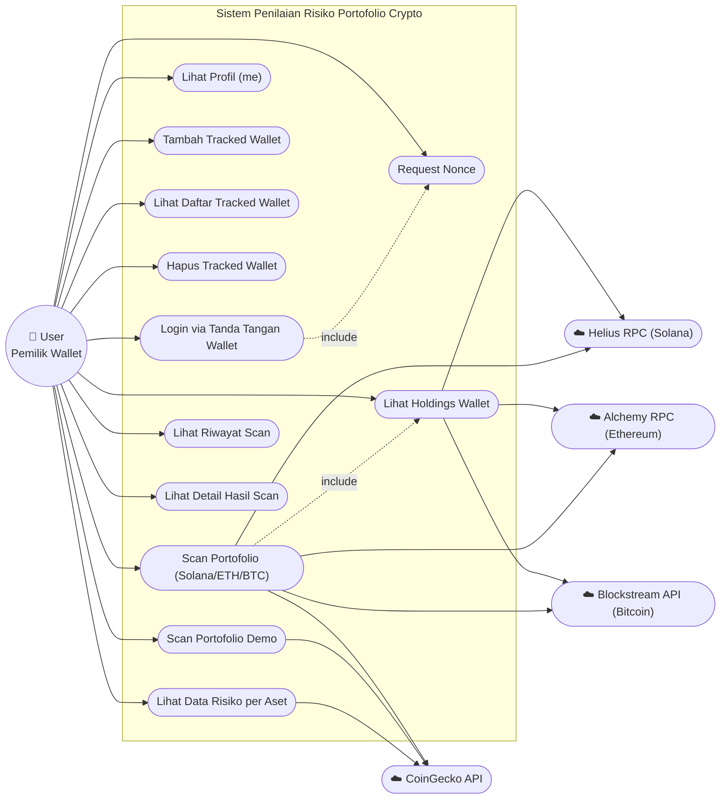
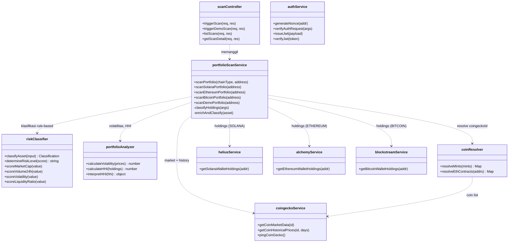
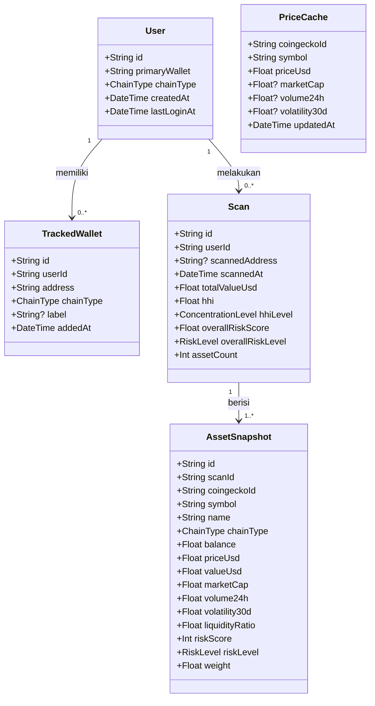
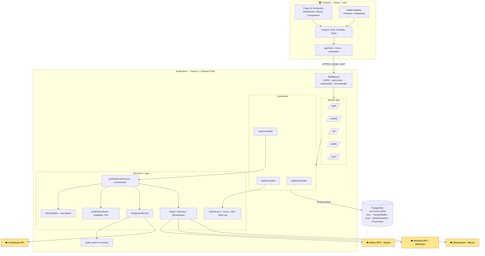

# Diagram Sistem — Penilaian Risiko Portofolio Cryptocurrency

> Semua diagram pakai **Mermaid** (bisa di-render langsung di GitHub, VS Code +
> ekstensi Mermaid, atau https://mermaid.live). Diagram ini dibikin dari kode
> aktual (routes, services, Prisma schema), bukan placeholder.
>
> Buat skripsi: Use Case & Activity → BAB 3 (Perancangan), Class & Arsitektur →
> BAB 3/BAB 4 (Implementasi).

---

## 1. Use Case Diagram

Menggambarkan interaksi User (pemilik wallet) dengan sistem. Sistem
berkomunikasi dengan API eksternal (CoinGecko, Helius, Alchemy, Blockstream).



**Catatan boundary:**
- `Login` **include** `Request Nonce` (nonce wajib didapat dulu sebelum sign).
- `Scan Portofolio` butuh holdings (RPC chain) **dan** data market (CoinGecko).
- Bitcoin cuma bisa di-*track*/scan, **gak bisa login** (gak ada standar sign-in web).

---

## 2. Activity Diagram — Scan Portofolio

Alur lengkap saat User trigger `POST /api/scan/:chainType/:address`.
Mengikuti orchestrator di `portfolioScanService.js`.

```mermaid
flowchart TD
    start([User trigger Scan Portofolio]) --> auth{JWT valid?}
    auth -- Tidak --> err401[401 Unauthorized] --> stop1([Selesai])
    auth -- Ya --> validate{Format address<br/>& chainType valid?}
    validate -- Tidak --> err400[400 INVALID_ADDRESS] --> stop2([Selesai])
    validate -- Ya --> own{User pemilik address?<br/>primary / tracked}
    own -- Tidak --> err403[403 FORBIDDEN] --> stop3([Selesai])

    own -- Ya --> fetch[Ambil holdings dari RPC chain<br/>Helius / Alchemy / Blockstream]
    fetch --> empty{Ada holding?}
    empty -- Tidak --> err422a[422 EMPTY_WALLET] --> stop4([Selesai])

    empty -- Ya --> resolve[Resolve mint/contract → coingeckoId<br/>via CoinGecko coin list]
    resolve --> split[Split: classifiable vs unclassified]
    split --> hasClass{Ada aset<br/>classifiable?}
    hasClass -- Tidak --> err422b[422 NO_CLASSIFIABLE_ASSETS] --> stop5([Selesai])

    hasClass -- Ya --> enrich[Per aset paralel - batasi konkurensi:<br/>fetch market data + history 30d]
    enrich --> calc[Hitung volatilitas 30d<br/>+ rasio likuiditas]
    calc --> classify[classifyAsset - rule-based<br/>skor 0-12 → Low/Medium/High]
    classify --> anyOk{Min. 1 aset<br/>berhasil?}
    anyOk -- Tidak --> err422c[422 ALL_ASSETS_FAILED] --> stop6([Selesai])

    anyOk -- Ya --> agg[Agregasi: total value, weights,<br/>HHI + interpretasi, overall risk tertimbang]
    agg --> persist[(Simpan Scan + AssetSnapshot[]<br/>dalam 1 transaksi DB)]
    persist --> resp[Return hasil scan + scanId]
    resp --> done([Selesai])
```

---

## 3. Class Diagram

Dua kelompok: **(A)** modul service/logic backend dan **(B)** entitas data (Prisma).
Service di-style sebagai modul fungsi (project pakai ES module functional, bukan OOP).

### 3A. Modul Service & Logika Inti



### 3B. Entity / Data Model (Prisma)



> `PriceCache` berdiri sendiri (tanpa relasi) — cache persisten data CoinGecko,
> bisa di-share lintas user & survive restart.

---

## 4. Diagram Arsitektur Sistem

Arsitektur 3-tier: Client (React) → Backend (Express) → Data (PostgreSQL) + API eksternal.



**Prinsip arsitektur kunci (buat dijelasin pas sidang):**
1. **API key disembunyiin di backend** — frontend gak pernah pegang key CoinGecko/Helius/Alchemy.
2. **Logika inti skripsi (rule-based + HHI) terisolasi** di `riskClassifier.js` & `portfolioAnalyzer.js`, gampang di-unit-test.
3. **Chain-agnostic orchestrator** — `classifyHoldings()` ditulis sekali, dipakai semua chain (Solana/ETH/BTC) + demo.
4. **Caching** di `coingeckoService` (node-cache) + `PriceCache` (DB) buat hindari rate limit CoinGecko (30 calls/min free tier).
```
